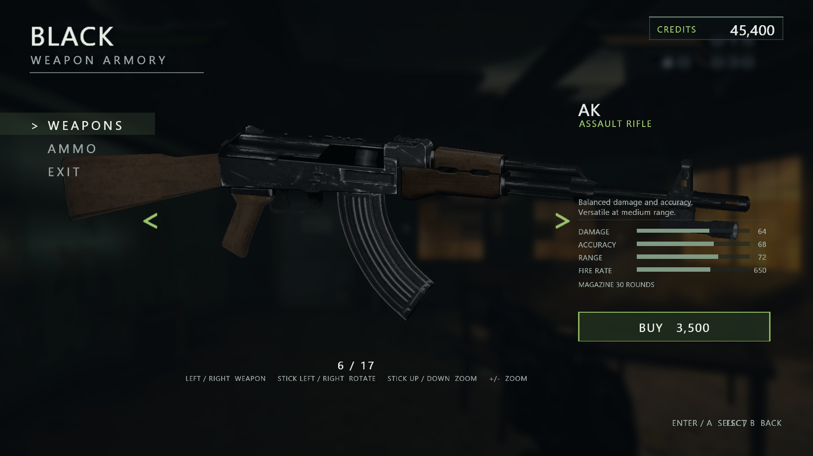
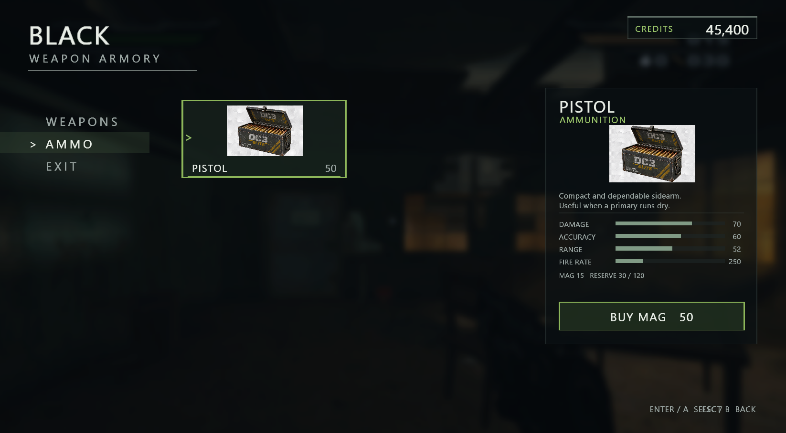
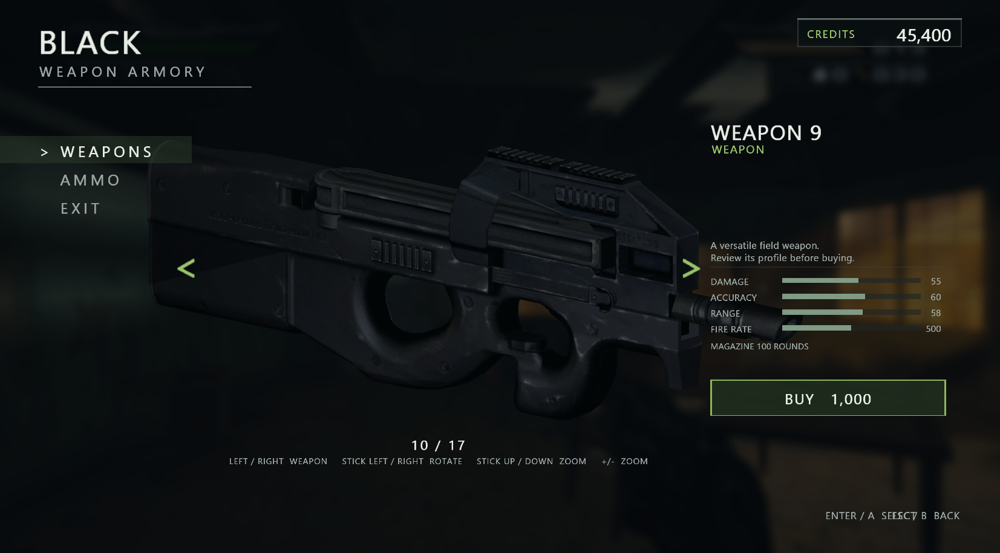
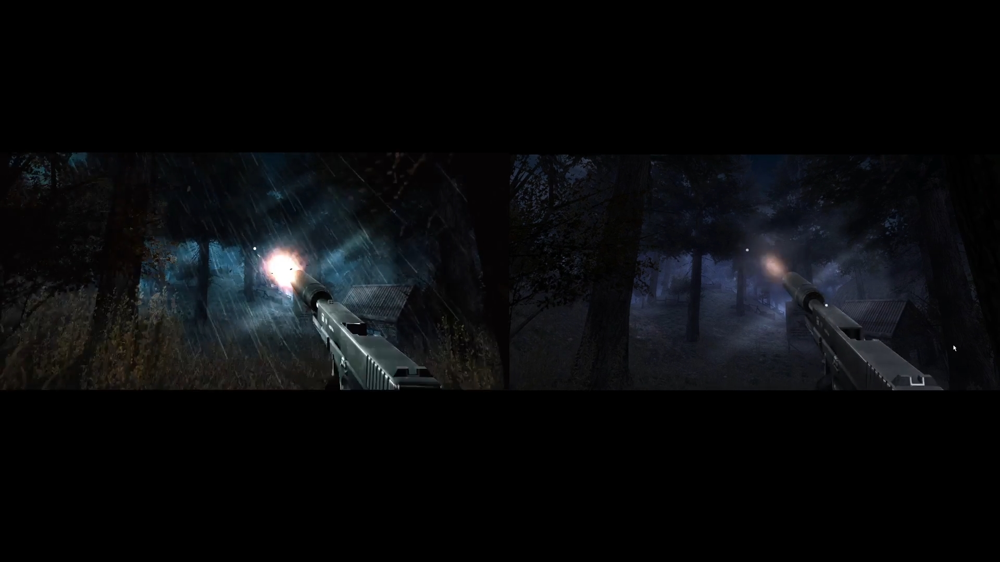

# BLACK (2006) – Modding Tools Release

This release includes tools for weapon and animation replacement, texture editing, and experimental gameplay and weather effects for **BLACK (2006) PC**.

The tools are still a work in progress. Some features are experimental, and tutorials will be added as development continues.

## 1. Weapon and Animation Replacer

### Standalone Python Application (Older Build)

1. Run `main_ui.py`.
2. Locate your game files (for example, `C:\black\game`).
3. The application will back up the original `.db` files and prepare the modding workspace.
4. Extract animations, export them as FBX, edit them, and rebuild the `.db` files.

### Maya Weapon and Animation Tools (Latest)

The latest Maya tools allow you to replace weapon models and animations directly inside Maya.

Features include:
- Weapon model replacement.
- Animation importing and exporting.
- Skinning transfer support.

**Important – Settings path**

In `maya_black_mod_UI.py`, update the settings path on line 28:

```python
SETTINGS_JSON = r"C:/Users/settings.json"
```

Make sure `settings.json` is located in the same folder as `main_ui.py`.

The workflow is fairly straightforward, but I'll be adding tutorials to explain the process in more detail.

**Important – High-resolution models and textures**

For high-poly weapon models and larger textures, launch the game with:

```bash
black.exe --buf-mb 8
```

This increases the weapon-data buffer size. Without it, you may encounter a **DISK ERROR** when loading larger assets.

## 2. Texture Replacement

BLACK uses the RenderWare engine, so its texture setup is different from modern engines.

- **Base Color:** Used for the main texture.
- **Alpha:** Used to control transparency and surface appearance, including shiny or metallic-looking areas.

There are two ways to replace textures:

### SubCraft Fork

A modified fork of SubCraft that supports loading BLACK `.db` files, editing textures, and rebuilding the database through the Export window.

### Standalone Python Texture Tool

Run:

```bash
mod_codes/black_texture_tool.py
```

This tool allows you to replace textures without using SubCraft.

## 3. BLACK Loader – Experimental Features

The loader is based on **Spark198rus' BLACK PC loader** and includes several additional features:

- **Weather and storm effects:** Rain, wind, falling leaves, thunder, and fog.
- **Tracer ammunition.**
- **Weapon armory:** Buy weapons in-game.
- **Point system.**
- **Color grading.**

Weather effects can be adjusted through the INI configuration file.

### Weather FX – Alpha Stage

The weather effects are currently enabled across all missions, but most of the development, testing, and tweaking has been focused on **Mission 2**.

Expect visual issues, performance problems, and inconsistencies in other missions.

### FX Development – Community Contributions Welcome

The FX system is still in its early stages. I would be glad to see the community experiment with it, improve existing effects, and contribute new ideas.

Feedback, bug reports, and contributions are very welcome!

---

## Notes

- Always keep backups of your original game files.
- Some tools and features are still experimental.
- Tutorials and documentation will be added as the project develops.

**Enjoy modding BLACK (2006)!**


## Screenshots & Features

### Weapon Armory

The new in-game weapon purchasing system.

| Weapon Armory – AK | Ammo Selection |
|:---:|:---:|
|  |  |

| Weapon Preview |
|:---:|
|  |

### Muzzle Flash Effects



### Weather & Environmental Effects

Experimental weather and lighting improvements in BLACK (2006).

The armory 3D weapon inspect using Gmesh format you can convert DB to Gmesh using python code ```db_to_gmesh.py```

| Weather FX – Showcase 1 | Weather FX – Showcase 2 |

ea
